<h1 align="center">
  <picture>
    <source media="(prefers-color-scheme: dark)" srcset="docs/assets/janus-lockup-dark.png">
    
  </picture>
</h1>

[](https://github.com/risadams/Janus/releases) [](https://github.com/risadams/Janus/actions/workflows/test.yml) [](go.mod) [](LICENSE) [](https://scorecard.dev/viewer/?uri=github.com/risadams/Janus) [](https://www.bestpractices.dev/projects/15550)

**Documentation: [risadams.github.io/Janus](https://risadams.github.io/Janus/)**

Janus is a small proxy that sits on your machine between Claude Code and
the Anthropic API. Out of the box it forwards every request untouched and
writes down what each one cost. Everything else is a switch you turn on
when you want it: sending some of the work to a local model in LM Studio,
keeping secrets and private files on your machine, or keeping a session
going after Claude goes down or your usage runs out.

<picture>
  <source media="(prefers-color-scheme: dark)" srcset="docs/diagrams/architecture-dark.svg">
  
</picture>

While Claude Code works, Janus prints a line for each request: who answered,
how long it took, how it ended, the tokens and how many came from the
prompt cache, and what it would cost at list price. Here subagents are
answered by a local model, and one local answer fails Janus's checks and
goes to Claude instead:


<sub>Made-up requests against stand-in backends; [reading the
console](docs/guide/use.md#reading-the-console) explains each column.</sub>

## Why

Claude Code is easy to run and hard to see into. A long session makes
hundreds of requests, and nothing tells you which ones cost what. Janus
keeps a ledger line for each, and `janus stats` adds them up by kind of
request, model, and backend.

A local model can be tried without trusting it. In shadow mode it answers
alongside Claude and only the answers are compared; in
local-then-escalate mode it answers subagent turns, and Claude takes over
whenever an answer fails its checks. Only once you are happy with it does
it need to answer on its own.

Secrets can be replaced with placeholders before a request leaves and put
back in the answer, and files you name never reach Anthropic at all. When
Claude is unreachable or rate limited, which on a subscription is what
running out of usage looks like, a rule can have the local model stand in.

## Quick start

You need Claude Code. LM Studio is only needed for the local-model
features. [Before you start](docs/guide/before-you-start.md) says what each
feature needs and which settings differ from their defaults.

On macOS or Linux with [Homebrew](https://brew.sh), for stable releases:

```bash
brew install risadams/tap/janus
```

`brew upgrade` then keeps it current, and the tab-completion scripts are
installed with it. With Go 1.27 or later, install the newest release:

```bash
go install github.com/risadams/janus/cmd/janus@latest
```

Or download a build. This finds the newest stable release on the
[releases page](https://github.com/risadams/Janus/releases), downloads
the build for macOS on Apple silicon, and checks it against the
published checksums:

```bash
url=$(curl -s https://api.github.com/repos/risadams/Janus/releases/latest | grep -m1 -o 'https://[^"]*_darwin_arm64\.tar\.gz')
curl -LO "$url"
curl -LO "${url%/*}/checksums.txt"
shasum -a 256 -c checksums.txt --ignore-missing
```

`checksums.txt` is itself signed, so that a replaced release is caught
too; [SECURITY.md](SECURITY.md#checking-a-download) says how to check
the signature with OpenSSL. Each archive also carries a signed record of
the workflow and commit that built it. If you have the GitHub CLI, check that too, then unpack:

```bash
gh attestation verify "${url##*/}" --repo risadams/Janus
tar -xzf "${url##*/}"
cd janus_*_darwin_arm64
```

For another machine, swap `darwin_arm64` for `darwin_amd64`,
`linux_amd64`, or `linux_arm64`. On Windows, winget (`winget install RisAdams.Janus`) and Scoop
(`scoop bucket add risadams https://github.com/risadams/scoop-bucket`, then
`scoop install risadams/janus`) install stable releases; the Windows builds
are also `.zip` files on the
releases page. The macOS binaries are signed with a Developer ID and
notarized by Apple, so macOS runs them however they were downloaded.

Check the setup, then start Janus (drop the `./` if you installed with
Homebrew or `go install`):

```bash
./janus doctor
./janus
```

The first run writes `janus.config.json` in the current directory. In
another terminal, start Claude Code through Janus:

```bash
./janus claude
```

`janus claude` checks that Janus is answering, then runs `claude` with
`ANTHROPIC_BASE_URL=http://127.0.0.1:8787` and `ENABLE_TOOL_SEARCH=true`
set; Janus's startup banner shows how to set them yourself instead.

Work as usual. Afterwards, see where the tokens went:

```bash
./janus stats -since 24h
```

The [quick start guide](docs/QUICKSTART.md) carries on to sending your
first requests to a local model, and the [user guide](docs/guide/README.md)
covers installing on every platform, configuring, everyday use, and
troubleshooting in full.

## What happens to a request

<picture>
  <source media="(prefers-color-scheme: dark)" srcset="docs/diagrams/request-flow-dark.svg">
  
</picture>

A request that the local-only policy keeps on your machine has no path to
Anthropic: if the local model cannot answer it, Janus refuses it. Each step
a request takes is recorded in the ledger, and
[what Janus changes](docs/WHAT-JANUS-CHANGES.md) lists them all.

## Features

Everything except the ledger is off until you switch it on in
`janus.config.json`.

| Feature | Switch | What it does | Guide |
| --- | --- | --- | --- |
| The books | always on | A ledger line per request, and full captures of requests and responses, kept 7 days | [Ledger](docs/LEDGER.md) |
| Routing | `features.route` and `routing` rules | Sends chosen requests to a local model, in shadow, local-then-escalate, or local mode | [Local first](docs/recipes/local-first.md), [subagents](docs/recipes/claude-code.md) |
| Pacing | a rule's `ifUsageAbove` | Sends a rule's requests local once a subscription usage limit is nearly used, before Claude refuses | [Pacing](docs/recipes/pace.md) |
| Providers | a rule's `fallback` list, `openai` | Sends a rule's requests to Claude, OpenAI, or a local model, in the order given, moving down the list when one cannot answer | [Providers](docs/recipes/providers.md) |
| Outage stand-in | a rule's `fallback` list | The local model answers when Claude cannot. Janus loads it if needed, and cuts a conversation too long for it down to its start and latest turns | [Outage](docs/recipes/outage.md) |
| Guard | `features.guard`, `guard.redact`, `guard.localOnly` | Finds secrets and swaps them for placeholders; keeps named files and markers away from Anthropic | [Guard](docs/GUARD.md), [privacy](docs/recipes/privacy.md) |
| Worker tools | `janus mcp` | Lets Claude hand file reading to the local model, and fetch the originals of digested output | [Workers](docs/recipes/workers.md) |
| Compression | `features.compress` | Replaces large tool results with digests written by the local model. Off by default, because it saved about 1.5% when measured | [Config](docs/CONFIG.md#compression), [evaluation](docs/research/digest.md) |

The [configuration reference](docs/CONFIG.md) has every setting.

## Commands

| Command | What it does |
| --- | --- |
| `janus` | Runs the proxy |
| `janus doctor` | Checks the config, port, upstream, LM Studio, log directory, and whether Claude Code is using Janus, and says what to fix; `-json` |
| `janus stats` | Tokens and estimated cost from the ledger; `-since 24h`, `-json` |
| `janus audit` | What left this machine, request by request; `-verify` re-reads what was sent; `-json` |
| `janus config upgrade` | Rewrites a config written for an older Janus in this version's form, keeping a copy |
| `janus route` | Where a saved request would go, and why |
| `janus replay` | Runs saved requests on the local model and compares its answers with Claude's |
| `janus mcp` | The MCP server for Claude Code's worker tools |
| `janus claude` | Starts Claude Code through Janus, after checking Janus is running |
| `janus service` | Installs, removes, or checks Janus as a service that starts at log in (macOS, Linux) |
| `janus version` | Prints the version; `-check` asks GitHub whether a newer release is out, `-pre` counts pre-releases |
| `janus update` | Replaces a copy installed from a release with the newest one, after checking its signature |
| `janus completion` | Prints tab completion for bash, zsh, fish, or PowerShell ([install](docs/guide/install.md#tab-completion-optional)) |

Each one takes `-h`.

## Good to know

Your credentials pass through untouched, and Janus never stores or logs
them. It listens on loopback only, and it refuses requests made by web
pages.

Captures hold your prompts and code in full. Only your user can read them,
and they are deleted after 7 days by default; set `logging.capture` to
`false` to stop them altogether.

One thing changes on every Messages request: Janus asks Anthropic for gzip
instead of brotli or zstd, so that it can read the answer.

Janus checks a local model's answers, but only for being broken: empty,
cut off, unreadable, a refusal, or a call to a tool it was not offered. A
well-formed wrong answer gets through. In the [measurements](docs/research/models.md), the
one model tried on one Mac was good enough for subagent turns and nothing
more.

The [threat model](docs/THREAT-MODEL.md) covers the rest, and
[troubleshooting](docs/TROUBLESHOOTING.md) the common problems.

## Status

Janus has stable releases but has not reached 1.0. Observing, routing,
escalation, worker tools, compression, and the guard are built and tested.
The [results report](docs/research/results-1.0.md) measures them
against the [charter](docs/CHARTER.md)'s goals over a week of everyday
use. Privacy, availability, explanation, and pass-through met their
targets. The saving did not: about 0.3%, against about 9%. The
[roadmap](docs/ROADMAP.md) has the milestones, and the [research
notes](docs/research/) the measurements behind each decision.

The diagrams' sources, for use elsewhere, are in [docs/diagrams](docs/diagrams/).

## Development

```bash
go test ./...
```

The tests run offline against fake servers.
[CONTRIBUTING.md](CONTRIBUTING.md) says how changes are made here, and
[AGENTS.md](AGENTS.md) has the full conventions, the opt-in tests against
real traffic, and the rules that keep Janus safe to change. Report security
problems as [SECURITY.md](SECURITY.md) describes.

## License

[MIT](LICENSE)
