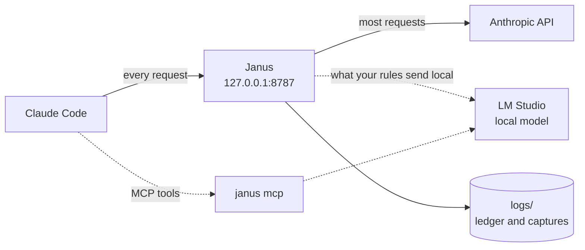
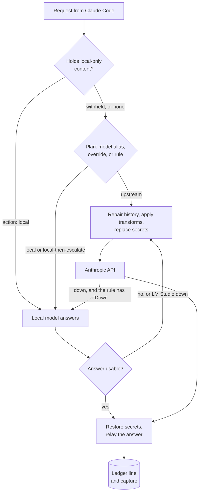

# Janus

[](https://github.com/risadams/Janus/actions/workflows/test.yml)

Janus is a proxy that runs on your machine between Claude Code and the
Anthropic API. It records what every request costs, and you can tell it to
send some work to a local model in LM Studio, keep secrets and private files
from leaving, and keep you working when Claude is down.



## Why

Claude Code is easy to run and hard to see into. Janus shows you, request
by request, what went where and what it cost, and gives you levers you can
pull one at a time:

- **See the spend.** A ledger line per request and `janus stats` break
  tokens and estimated cost down by kind of request, model, and backend.
- **Try a local model safely.** Run it alongside Claude and only compare
  (`shadow`), let it answer but check each answer and ask Claude when it
  fails (`local-then-escalate`), or trust it outright (`local`).
- **Keep things private.** Secrets can be swapped for placeholders before a
  request leaves and put back in the answer. Files and markers you name
  never go to Anthropic at all.
- **Ride out an outage.** A rule can have the local model stand in when
  Claude is unreachable or rate-limited.

With nothing switched on, Janus forwards everything untouched and only
keeps the books.

## Quick start

You need Claude Code. LM Studio is only needed for the local-model
features.

Download the archive for your machine from the
[releases page](https://github.com/risadams/Janus/releases). The current
release is the pre-release `v0.9.0-rc.4`:

```bash
curl -LO https://github.com/risadams/Janus/releases/download/v0.9.0-rc.4/janus_0.9.0-rc.4_darwin_arm64.tar.gz
curl -LO https://github.com/risadams/Janus/releases/download/v0.9.0-rc.4/checksums.txt
shasum -a 256 -c checksums.txt --ignore-missing
tar -xzf janus_0.9.0-rc.4_darwin_arm64.tar.gz
cd janus_0.9.0-rc.4_darwin_arm64
```

Other builds are `darwin_amd64`, `linux_amd64`, `linux_arm64`, and, as
`.zip`, `windows_amd64` and `windows_arm64`. The binaries are not signed: a
copy downloaded in a browser on macOS is quarantined, which
`xattr -d com.apple.quarantine janus` clears. Or build it with Go 1.25 or
later:

```bash
go install github.com/risadams/janus/cmd/janus@latest
```

Check the setup, then start it (drop the `./` if you used `go install`):

```bash
./janus doctor
./janus
```

On first run Janus writes `janus.config.json` in the directory you run it
from, and prints the command that points Claude Code at it. In another terminal:

```bash
ANTHROPIC_BASE_URL=http://127.0.0.1:8787 ENABLE_TOOL_SEARCH=true claude
```

Work as usual, then see where the tokens went:

```bash
./janus stats -since 24h
```

The [quick start guide](docs/QUICKSTART.md) goes on to the first local
route.

## What happens to a request



A request the local-only policy keeps local never takes a path to
Anthropic: if the local model cannot answer it, it is refused. Every step
taken is recorded in the ledger, and
[what Janus changes](docs/WHAT-JANUS-CHANGES.md) lists each one.

## Features

Everything is off until you switch it on in `janus.config.json`.

| Feature | Switch | What it does | Guide |
| --- | --- | --- | --- |
| The books | always on | A ledger line per request; full captures of requests and responses, kept 7 days | [Ledger](docs/LEDGER.md) |
| Routing | `features.route` and `routing` rules | Sends chosen requests to a local model: shadow, local-then-escalate, or local | [Local first](docs/recipes/local-first.md), [subagents](docs/recipes/claude-code.md) |
| Outage stand-in | a rule's `ifDown` | The local model answers when Claude cannot | [Outage](docs/recipes/outage.md) |
| Guard | `features.guard`, `guard.redact`, `guard.localOnly` | Finds secrets, swaps them for placeholders, and keeps named files and markers off Anthropic | [Guard](docs/GUARD.md), [privacy](docs/recipes/privacy.md) |
| Worker tools | `janus mcp` | Lets Claude hand reading to the local model, and fetch originals of digested output | [Workers](docs/recipes/workers.md) |
| Compression | `features.compress` | Replaces large tool results with local-model digests. Off by default: it measured at about 1.5% saved | [Config](docs/CONFIG.md#compression), [evaluation](docs/research/digest.md) |

Every setting is in the [configuration reference](docs/CONFIG.md).

## Commands

| Command | Does |
| --- | --- |
| `janus` | Runs the proxy |
| `janus doctor` | Checks the config, port, upstream, LM Studio, and log directory, and says what to fix |
| `janus stats` | Tokens and estimated cost from the ledger; `-since 24h`, `-json` |
| `janus audit` | What left this machine, request by request; `-verify` re-reads what was sent |
| `janus route` | Where a saved request would go, and why |
| `janus replay` | Runs saved requests on the local model and compares the answers with Claude's |
| `janus mcp` | The MCP server for Claude Code's worker tools |
| `janus version` | Prints the version |

Each one takes `-h`.

## Good to know

- **Your credentials pass through untouched**, and Janus never stores or
  logs them. It listens on loopback only, and refuses requests from web
  pages.
- **Captures hold your prompts and code** in full, readable by you only,
  for 7 days by default. Set `logging.capture` to `false` to stop them.
- **One header changes on the way out:** on Messages requests Janus asks
  for gzip rather than brotli or zstd, so it can read the answer.
- **Local models are judged, not trusted.** The checks catch broken
  answers, not wrong ones. The [measurements](docs/research/models.md)
  found one model on one Mac fit for subagent turns only.

The [threat model](docs/THREAT-MODEL.md) covers the rest, and
[troubleshooting](docs/TROUBLESHOOTING.md) the common problems.

## Status

Janus is in pre-release. Observing, routing, escalation, worker tools,
compression, and the guard are built and tested; the 1.0 results report
waits on a week of everyday use. The [roadmap](docs/ROADMAP.md) has the
milestones, the [charter](docs/CHARTER.md) the goals, and
[research notes](docs/research/) the measurements behind each decision.

Diagrams for use outside GitHub are in [docs/diagrams](docs/diagrams/).

## Development

```bash
go test ./...
```

The suite runs offline against fake servers. [AGENTS.md](AGENTS.md) has
the conventions, the opt-in tests on real traffic, and the rules that keep
Janus safe to change.

## License

[MIT](LICENSE)
