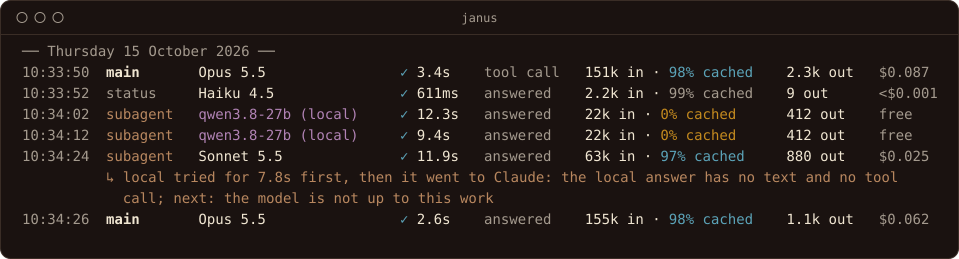

# Using Janus

Once Janus is [installed](install.md) and [configured](configure.md),
day-to-day use is: leave it running, use Claude Code as usual, and look at
what Janus wrote down when you want to know something. This page shows
what Janus prints and what each command tells you.

Each command answers one question you could not easily answer before:

| Question | Command |
| --- | --- |
| Where did my usage go? | [`janus stats`](#where-the-tokens-went-janus-stats) |
| What left my machine? | [`janus audit`](#what-left-your-machine-janus-audit) |
| What will this rule do? | [`janus route`](#where-would-this-go-janus-route) |
| Is the local model good enough for this work? | [`janus replay`](#is-the-local-model-good-enough-janus-replay) |

Most days you only need the console.

## Starting and stopping

```bash
janus
```

Janus prints what it will do, then a line per request:

```
janus vX.Y.Z

  Listening   http://127.0.0.1:8787
  Upstream    https://api.anthropic.com
  Local       http://127.0.0.1:1234
  Routing     model "janus-local" -> local qwen/qwen3.8-27b
              rule main: class main -> upstream, or local qwen/qwen3.8-27b if Claude cannot answer
              rule subagents: class subagent -> upstream, or local qwen/qwen3.8-27b if Claude cannot answer
  Ledger      /Users/you/Library/Application Support/janus/ledger
  Captures    /Users/you/Library/Application Support/janus/captures (full prompts and responses)

Start Claude Code through janus:

  janus claude

  # or set the variables yourself: bash / zsh / fish
  ANTHROPIC_BASE_URL=http://127.0.0.1:8787 ENABLE_TOOL_SEARCH=true claude
  ...
```

`janus use codex` (or `claude`, `local`) moves every running session,
or one with `-session`, from its next turn, until `janus use -clear`.
`janus claude -provider openai` starts a session with OpenAI first, and
`janus local` one on the local model only, through the same Janus; other
sessions keep following the rules
([choosing the route yourself](../CONFIG.md#choosing-the-route-yourself)).

Read the `Routing` lines after any config change: they are the rules as
Janus understood them, which is not always what you meant. The first rule
that matches a request decides where it goes, so a broad rule above a
narrow one hides it, and these lines show the order.

Press Ctrl+C to stop. Answers still streaming get up to a minute to
finish, and new ones are refused meanwhile; press Ctrl+C again to stop at
once. Claude Code sessions pointed at Janus can't reach Claude while it
is stopped.

## Reading the console

Each request gets one line when it finishes. In color, it looks like this:



<sub>Made-up requests against stand-in backends. Another example follows
as plain text.</sub>

```
main       Opus 5.5                ✓ 20.6s   tool call   151k in · 98% cached    2.3k out   $0.092
subagent   Sonnet 5                ✓ 967ms   answered    84k in · 97% cached     9 out      $0.022
main       qwen3.8-27b (local)     ✓ 3.2s    answered    22 in                   37 out     free
main       Opus 5.5                ✗ 429 505ms  rate limited
```

From left to right:

| Column | What it says |
| --- | --- |
| Kind | `main` is your conversation; `subagent` a helper Claude Code started. Claude Code's background requests (`status`, `safety`, `quota`, `compact`, `count`, `ping`) are dimmed. |
| Model | Who answered. A local model is marked `(local)`. |
| Result | `✓` and how long it took, or `✗` with the HTTP status. `✗ refused` means Janus refused it itself. |
| Ending | How the answer ended: `answered`, `tool call` (Claude wants to run a tool), `cut off`, `max tokens`, `refused`. A failure says what it was instead, such as `rate limited`. |
| Tokens | Tokens sent, and how many of them were read from the prompt cache, then tokens written back. |
| Cost | The estimate at Anthropic's list price. Local answers are `free`. |

A line starting `↳` underneath says something worth knowing about that
request:

```
subagent   Opus 5.5                ✓ 20.6s   answered    2 in                    9 out      <$0.001
          ↳ local tried for 9.3s first, then it went to Claude: the local answer has no text and no tool call
```

Here the local model tried a subagent turn, its answer failed the checks,
and Claude answered. Notes in yellow or red are the ones to read. Notes
about the guard are said once per conversation, not on every turn.

On a subscription, notes also say how much of its usage limits is used:
once at the first answer, then each time a limit passes another tenth,
and when one resets.

```
main       Opus 5.5                ✓ 4.1s    tool call   188k in · 99% cached    310 out    $0.041
          ↳ five-hour limit 80% used, resets at 15:30
```

From 80% the note is yellow; at the limit it is red, and Claude refuses
requests until it resets. The weekly limit is reported the same way.

On a subscription the cost column is not a bill. It is what the same
usage would cost through the API, which is useful for comparing one day,
or one setup, with another.

## Where the tokens went: `janus stats`

```bash
janus stats -since 24h
```

`-since` and `-until` take an age (`24h`, `7d`), a date (`2026-10-01`),
or a time. `-daily` adds a row per day, to compare one day with the next after a
change. `-json` gives the same figures as JSON. A report looks like this:

```
Ledger /Users/you/Library/Application Support/janus/ledger
2026-10-14 09:00 to 2026-10-14 17:30 (local time), 412 requests

By class
           class  requests    input  cache write  cache read   output  cache hit  est. cost
            main       263    6,120      402,118  51,220,904  188,503      99.2%   $17.2310
        subagent        58   92,407       21,330   2,410,662   41,880      95.4%    $0.6411
          safety        61    5,490      221,004   7,301,550      542      97.0%    $2.3802
          status        30   71,033       80,902   1,390,115    1,021      90.1%    $0.9855
           total       412  175,050      725,354  62,323,231  231,946      98.6%  $21.2378

Saved by answering locally
  44 requests the local model answered would have cost about $1.2604 had
  Claude answered them, at the list price of the model each asked for. The
  local model counts and caches tokens differently from Claude, so read it as
  the size of the saving, not an exact figure.

Local first (the local model tried, with Claude as the fallback)
       class  tried  accepted  rejected  failed  accepted %  attempt time
    subagent     58        44         5       9         76%         31.2s

Main conversation by context size
          context  turns  of turns  est. cost  of cost  per turn (median)
       under 200k    151       57%    $5.8102      34%             $0.039
        200k-400k     89       34%    $7.0215      41%             $0.077
        400k-600k     23        9%    $4.3993      26%             $0.188
  Each turn reads the whole conversation from the cache, so it costs more
  as the conversation grows. /compact, or a new session, starts it small again.

Why the local model did not answer, and what to do about it
  cause      tried  never tried  next step
  busy       0      6            raise maxConcurrent, if the machine has the memory
  rejected   5      0            the model is not up to this work
  slow       9      0            raise maxSeconds or timeoutSeconds, or use a faster model
```

These figures are made up; yours will differ. The report also breaks the
totals down by model and by backend, lists outcomes, and, if Claude
turned requests away, says when and why under "When Claude could not
answer": a rate limit names the subscription limit reached and when it
lifts.

What to look for:

- **The cache hit rate.** Claude Code reads most of each request from the
  prompt cache, so cache reads dominate. A rate that drops sharply after a
  change means something is making requests differ from turn to turn,
  and each miss is paid for at twenty times the price of a read
  ([why](../WHAT-JANUS-CHANGES.md#why-the-list-is-short)).
- **`safety` and `status`.** In auto mode, Claude Code checks each tool
  call with a separate request (`safety`), and asks for short progress
  lines while subagents run (`status`). They can add up.
- **Main conversation by context size.** Each turn reads the whole
  conversation from the cache, so a turn at 600k tokens costs about four
  times one under 200k. If the larger rows carry most of the cost, a
  `/compact` sooner, or a new session for a new task, would cut it. The
  console says so as it happens: once a conversation passes 400k tokens
  (`console.contextWarnTokens`), a note under its line gives what a turn
  costs now and what it cost when the conversation was small. Over a week
  of real use it looked like this:

  
  

  This is the biggest thing you control. Janus cannot shrink a
  conversation without breaking the cache, but you can, at the moment it
  costs least: between tasks. The [baseline](../research/baseline.md) has
  the full figures.
- **Usage limits**, on a subscription: how much of the five-hour and
  weekly limits was used at the last answer, when each resets, and which
  kinds of request used the five-hour limit in the range. The shares are
  rough, but they say where to look: if `safety` is a large share, auto
  mode's checks are using up your limit.
- **Saved by answering locally**, if you route requests locally: what
  the local model's answers would have cost had Claude given them. It is
  a rough figure, since the local model counts tokens its own way, but it
  is the saving routing made. Compare it with the time the local model
  took, in the next table.
- **The "Local first" table**, if you route subagents locally. `accepted`
  answers came from the local model at no cost. `rejected` ones came back
  whole and failed a check; `failed` ones never gave an answer to judge.
  Claude answered both, after the attempt time had already been spent. If
  few are accepted, the local model is costing you time and saving
  nothing.
- **Why the local model did not answer.** Each cause comes with its next
  step. `tried` counts attempts that ended that way; `never tried` counts
  requests a rule sent to Claude without trying, such as when the model
  was busy. Mostly `slow`: raise `maxSeconds` or use a faster model.
  Mostly `rejected`: the model isn't up to the work. The full list is in
  [the ledger](../LEDGER.md#why-the-local-model-did-not-answer).

### Keeping an eye on it while you work

```bash
janus stats -watch
```

shows today's figures in a terminal and redraws them every five seconds
until you press Ctrl+C:

```
Janus today, Thursday 15 October, at 14:30:05 (every 5s; Ctrl+C to stop)

  requests   412, 3 failed
  cost       $21.2378 at list price
  cache hit  98.6%
  local      44 answered, saving about $1.2604; 44 of 58 tried first were accepted
  limits     five-hour 35% used, resets at 16:30 · weekly 6% used, resets Mon 00:00
```

These figures are made up. Lines for local answers, stand-ins, and limits
appear when there is something to say. Keep it open in a second terminal
beside Claude Code. Piped or redirected, it prints once and exits.

[The ledger](../LEDGER.md) explains each figure.

## What left your machine: `janus audit`

```bash
janus audit -since 24h
```

The ledger records what Janus meant to do with each request. `audit`
reads it back to answer the question that matters for privacy, which is
not what Janus intended but what actually left. The summary counts the
requests carrying your content by where they went:
to Anthropic as your client sent them, to Anthropic changed by Janus (a
secret replaced, a private file withheld), to the local model only, or
nowhere. It then lists any secrets found.

```bash
janus audit -verify -since 24h
```

`-verify` does not take the ledger's word for it: it reads again what was
actually sent, with the guard's current detectors, to catch anything that
slipped past them at the time. Use it after adding a pattern to
`guard.patterns`, to learn whether that secret had already gone. It exits
non-zero when it finds something, so it can run from a script.

To look at one request, give its id:

```bash
janus audit 20261014T123040.721-24a02d
```

```
Request 20261014T123040.721-24a02d
  When      2026-10-14 08:30:40
  What      POST /v1/messages, class main
  Went to   Anthropic
  Why       rule main
  Sent      /Users/you/Library/Application Support/janus/captures/2026-10-14/20261014T123040.721-24a02d_v1-messages.sent.txt
            (as janus sent it; your client's original is beside it as .request.txt)
```

The id is the time the request started, in UTC, and a short random
suffix. It is the `id` on each line of the ledger
(`logs/ledger/<date>.jsonl`) and the start of the capture's file name, so
to find a request you saw on the console, look for its time. Add `-body`
to print exactly what was sent.

In the commands below, `logs` stands for the log folder, as in
[configuring](configure.md#logs-and-captures).

## Where would this go: `janus route`

```bash
janus route logs/captures/2026-10-14/20261014T123040.721-24a02d_v1-messages.request.txt
```

`route` takes a saved request and says where your current config would
send it, rule by rule, and for a local route, what would change on the
way:

```
Request   claude-opus-5-5, class subagent (from the request's first system block), about 78,059 tokens, 8 tools

  rule main: no match (class is subagent, not main)
  rule subagents: local first, on qwen/qwen3.8-27b; its answer is checked, and Claude answers instead if it fails

Decision  local first: qwen/qwen3.8-27b answers, and its whole answer is checked before the client
          sees any of it. If it passes it is reported as claude-opus-5-5; if not, Claude answers.
          changes on the way: set_model, lift_tool_additions, fold_system_messages, drop_deferred_tools
```

Use it after editing `routing` to check a rule matches what you meant,
before restarting Janus. It is quicker than finding out from the console,
and it sends nothing anywhere. `-class` treats the request as another class, and
`-override` as if it had asked for a route itself.

## Is the local model good enough: `janus replay`

```bash
janus replay -class subagent -limit 20 logs/captures/2026-10-14
```

`replay` sends saved requests to the local model and compares each answer
with the one Claude gave: did it stop for the same reason, and call the
same tools? Nothing goes to Anthropic. It is the cheapest way to try a
model on your own work before routing anything to it: no session waits
on it, and a model that does badly costs you nothing but the time it
ran. Each answer is
saved beside its capture as `.replay.md`.

"Same" compares the shape of the answers, not whether they are right;
read a few of the `.replay.md` files before trusting it.

## Worker tools: `janus mcp`

`janus mcp` is an MCP server that gives Claude tools the local model
carries out, such as reading many files and answering a question about
them, so that the files never enter Claude's context. Claude Code starts
it; you add it once:

```bash
claude mcp add janus -- /full/path/to/janus mcp -config /full/path/to/janus.config.json
```

[The workers recipe](../recipes/workers.md) explains when it helps and
when it doesn't.

## When Claude is down

With a local model on a rule's `fallback` list ([configuring](configure.md#keep-working-when-claude-is-down)),
an outage looks like this on the console:

```
main       qwen3.8-27b (local)     ✓ 26.4s   tool call   53k in · 99% cached     254 out    free
          ↳ Claude could not answer (upstream answered HTTP 429), so the local model stood in, with older turns left out to fit its context
```

The session carries on, slower. A few things are different while it
lasts:

- **Turns take longer.** Tens of seconds each, sometimes more. The first
  one may also wait for LM Studio to load the model.
- **Long conversations are cut.** The local model sees the start of the
  conversation and its latest turns, with a note that the middle was left
  out. It may repeat work or miss a decision made earlier.
- **Requests queue.** The local model takes one at a time by default, so
  a subagent and the main conversation take turns.
- **Auto mode stops working.** Claude Code checks each tool call with
  Claude, and those checks are not sent to the local model. Janus says
  so:

  ```
            ↳ auto mode's safety check could not reach Claude, so Claude Code will refuse tool calls; press Shift+Tab to leave auto mode and approve them yourself while the local model stands in
  ```

  Press Shift+Tab to switch out of auto mode, and approve each tool call
  yourself until Claude is back.

When Claude answers again, the next request goes to it as usual. Nothing
needs switching back. Janus notes Claude's first answer to the main
conversation afterwards, since Claude reads the local model's turns as
its own: it is a good moment to ask Claude to check what was done
([outage recipe](../recipes/outage.md#what-to-expect)).

## Choosing the route yourself

A request can ask for its route with the `X-Janus-Route` header
(`upstream`, `local`, or `local=<name>`), and a request for a model alias
such as `janus-local` always goes to that local model. Claude Code sends
extra headers from `ANTHROPIC_CUSTOM_HEADERS`, so a whole session can opt
out of local routing:

```bash
ANTHROPIC_CUSTOM_HEADERS="X-Janus-Route: upstream" claude
```

Forcing `local` is a promise the request never goes to Anthropic: if the
local model can't take it, it is refused rather than quietly sent to
Claude, since keeping it from Anthropic may be the reason you forced it. The
[configuration reference](../CONFIG.md#choosing-the-route-yourself) has
the details.

When something isn't right, see [troubleshooting](../TROUBLESHOOTING.md).
